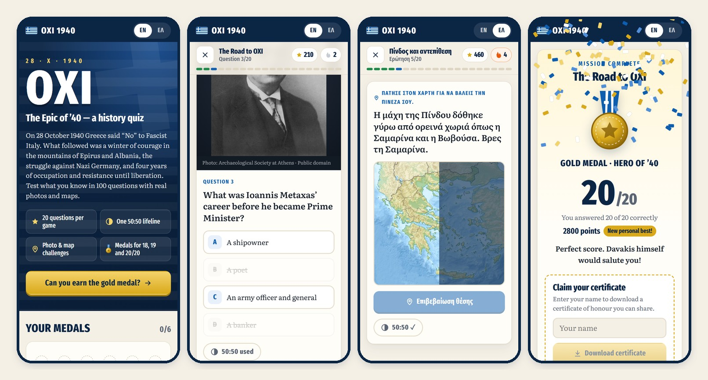
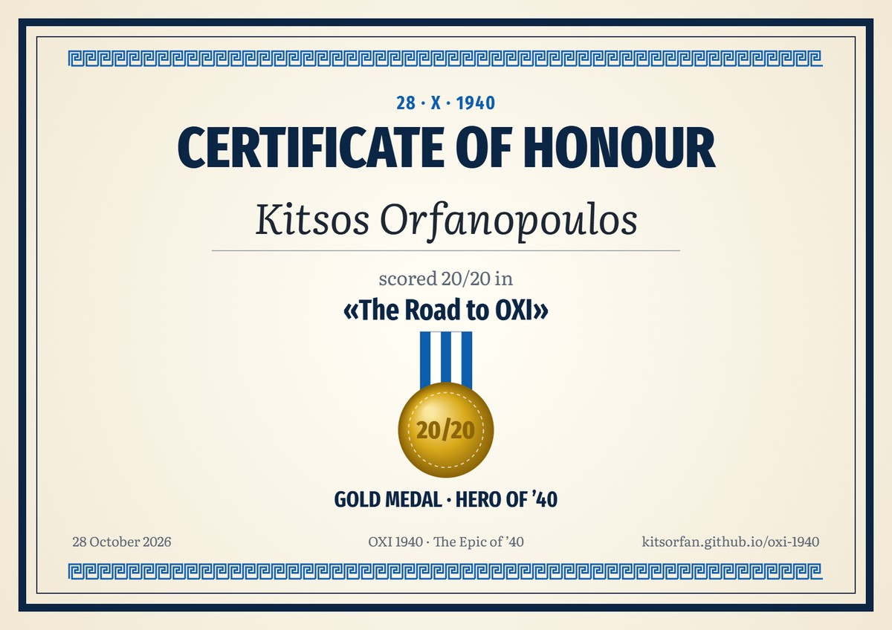

<div align="center">

# ΟΧΙ 1940 · The Epic of ’40

**A bilingual history quiz for Ochi Day: 100 questions on the Greek struggle of 1940–1945, with real photos and maps.**

[](https://github.com/kitsorfan/oxi-1940/actions/workflows/deploy.yml)
[](LICENSE)


### [▶ Play now: kitsorfan.github.io/oxi-1940](https://kitsorfan.github.io/oxi-1940/)



</div>

## What is it?

On 28 October 1940 Greece answered Mussolini’s ultimatum with a single word: **«ΟΧΙ» (“No”)**. This small game is a tribute to that day and to what followed. It covers the winter war in the mountains of Epirus and Albania, the German invasion, the Battle of Crete, the occupation, the Resistance and the liberation.

- **100 questions** in five chronological chapters of 20, plus a *Grand Challenge* that draws 20 at random from all of them.
- **Real photos and maps** from Wikimedia Commons, with the story behind every answer.
- **Find-it-on-the-map** questions: tap the relief map of Greece and see how many kilometres you were off.
- **One 50:50 lifeline per game.** It removes two wrong answers, or on map questions shades the half of the map without the target.
- **Medals for 18, 19 and 20 out of 20**, and a downloadable **certificate of honour** to share on LinkedIn.
- **English and Greek** throughout, switchable at any moment.
- **Made for phones first.** It works on any screen, keeps your best scores on your device and needs no account.

## The chapters

| # | Chapter | Period | Highlights |
|---|---------|--------|------------|
| 1 | The Road to OXI | 1923 – 28 Oct 1940 | Corfu 1923, the torpedoing of *Elli*, the night of the ultimatum, Ochi Day today |
| 2 | Pindus & the Counter-attack | Oct – Dec 1940 | Davakis and the Julia Division, Kalpaki, the women of the Pindus, Sofia Vembo, Korytsa |
| 3 | The Winter Front | Nov 1940 – Apr 1941 | Mitralexis, the submarine *Papanikolis*, frostbite, Klisura, Elytis, the Spring Offensive |
| 4 | Invasion & Crete | Apr – Jun 1941 | Operation Marita, Fort Rupel, Thermopylae, *Averof*, the Battle of Crete |
| 5 | Occupation & Liberation | 1941 – 1945 | Glezos and Santas, the famine, Gorgopotamos, the Holocaust in Thessaloniki, Rimini, liberation |

## Prizes

| Score | Medal | Title |
|-------|-------|-------|
| 20 / 20 | 🥇 Gold | Hero of ’40 · *Ήρωας του ’40* |
| 19 / 20 | 🥈 Silver | Guardian of the Pindus · *Φρουρός της Πίνδου* |
| 18 / 20 | 🥉 Bronze | Defender of Epirus · *Υπερασπιστής της Ηπείρου* |

Every medal comes with a certificate rendered in the browser, in the language you played in:



Points add up along the way: 100 for a correct answer, plus up to 50 for a streak of correct answers. A correct answer after the 50:50 is worth 50.

## Run it locally

You need Node.js 24 or newer.

```sh
npm ci           # install
npm run dev      # start at http://localhost:5173/oxi-1940/
npm test         # check the question bank and game rules
npm run build    # production build in dist/
```

Every push to `main` is type-checked, tested, built and published to GitHub Pages by [`.github/workflows/deploy.yml`](.github/workflows/deploy.yml).

## How it is built

React 19, TypeScript and Vite. There is no backend and no tracking: progress lives in `localStorage`.

```
src/
├── data/
│   ├── chapters/        # the 100 questions, one file per chapter (English + Greek)
│   └── images.ts        # every photo and map: file, author, licence, captions
├── game/
│   ├── engine.ts        # rounds, 50:50, scoring and medals (pure, unit-tested)
│   ├── geo.ts           # map projection and distances
│   └── certificate.ts   # draws the certificate on a canvas
├── components/          # Home, Quiz, MapPicker, Results, About …
└── i18n/strings.ts      # interface text in both languages
public/img/              # images from Wikimedia Commons, resized to WebP
test/                    # data integrity and game-rule tests
```

### Adding a question

Questions are plain objects with both languages side by side:

```ts
choice({
  id: 'p10',
  prompt: t('What famous battle cry did Greek soldiers shout…?', 'Ποια ιαχή φώναζαν οι Έλληνες στρατιώτες…;'),
  answer: t('«Αέρα!» (Aera!)', '«Αέρα!»'),
  wrong: [t('«Ζήτω!» (Zito!)', '«Ζήτω!»'), t('«Εμπρός!» (Embros!)', '«Εμπρός!»'), t('«Νίκη!» (Niki!)', '«Νίκη!»')],
  fact: t('The cry “Aera!” echoed across the mountains…', 'Η ιαχή «Αέρα!» αντήχησε στα βουνά…'),
}),
```

Map questions use `map({ … lat, lon, radiusKm })`. The tests check that every chapter has 20 questions, that every text exists in both languages, that options are distinct, that map targets fall on the map and that every image is used and credited.

## Sources and image credits

The questions are based on well-documented facts about the period. Where a story is uncertain, such as the famous phrase attributed to Churchill, the question says so.

All photos and maps come from [Wikimedia Commons](https://commons.wikimedia.org/) and are in the public domain or under free licences (CC0, CC BY, CC BY-SA). They were resized and converted to WebP for the web. The author, licence and source page of each image are listed in [`src/data/images.ts`](src/data/images.ts) and on the **About & credits** page of the game. The base map is Wikipedia’s *Greece relief location map* by Lencer and Uwe Dedering (CC BY-SA 3.0).

## Ελληνικά

Ένα δίγλωσσο κουίζ ιστορίας για την επέτειο της 28ης Οκτωβρίου: 100 ερωτήσεις για τον αγώνα της Ελλάδας από το 1940 ως την Απελευθέρωση, με αληθινές φωτογραφίες και χάρτες. Με 18, 19 ή 20 σωστές απαντήσεις κερδίζεις μετάλλιο και δίπλωμα τιμής. **[Παίξε εδώ](https://kitsorfan.github.io/oxi-1940/?lang=el)**.

## License

The code is released under the [MIT License](LICENSE). The images keep their own licences, as listed above.
